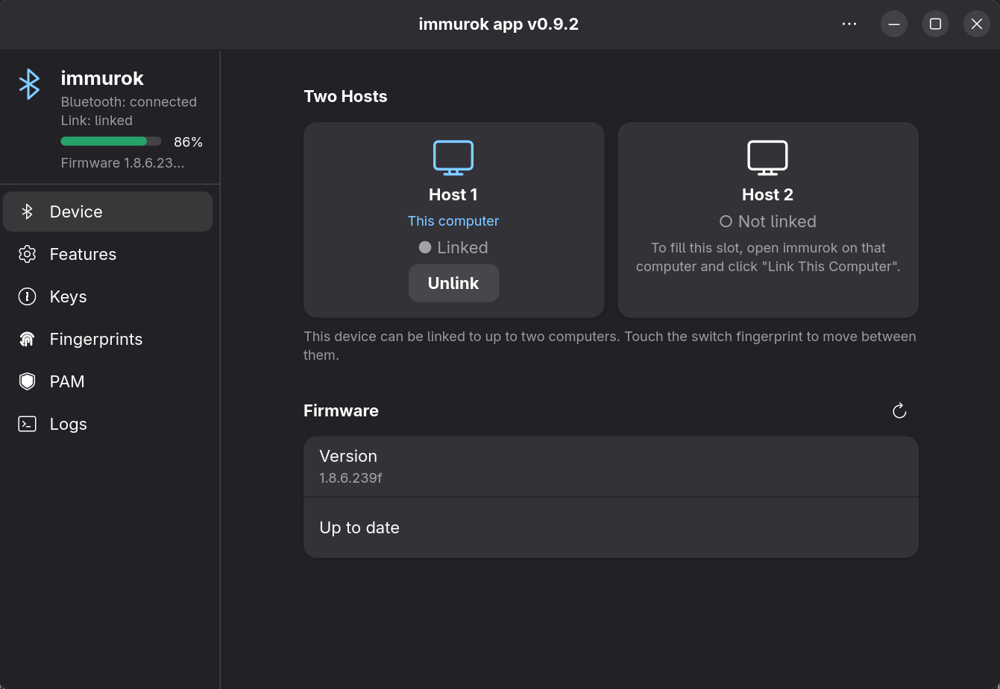

# immurok — Linux Companion App

Fingerprint authentication on Linux, backed by the immurok BLE device: touch the
sensor instead of typing your password for `sudo`, polkit prompts and screen
unlock. Verified on **Arch / Fedora 43+ / Debian 12+ / Ubuntu 24.04+**, GNOME and
KDE.



## Install

Packages for Debian/Ubuntu, Fedora and Arch (amd64 and arm64) are attached to every
[release](https://github.com/immurok/app-linux-rs/releases):

```bash
sudo apt install ./immurok_<version>-1_amd64.deb        # Debian / Ubuntu
sudo dnf install ./immurok-<version>-1.x86_64.rpm       # Fedora
sudo pacman -U immurok-<version>-1-x86_64.pkg.tar.zst   # Arch
```

Upgrading is the same command again. No package for your distribution? See
[Building from source](docs/install-from-source.md).

## First-time setup

**Open *immurok* from your app menu.** The setup wizard runs on first launch and
walks you through the three steps — connect over Bluetooth, link this computer,
enroll a fingerprint — checking each one before moving on.

Then open the **PAM** page and click *Install* for `sudo` and *System
authorization*. The package deliberately never edits `/etc/pam.d` on its own.

That's it. Try it:

```bash
sudo -k && sudo true     # should ask for your fingerprint, not your password
```

> Prefer a terminal? `immurok-cli tui` does everything the GUI does.
> Dismissed the wizard? The header menu brings it back, or `immurok-gui --setup`.

## What the app gives you

| Page | |
|---|---|
| **Device** | battery, firmware, and the two host slots — one device can be linked to two computers, with a dedicated fingerprint to switch between them |
| **Features** | which prompts the fingerprint answers: sudo, polkit, screen unlock, SSH |
| **Keys** | the device's SSH / OTP / API keystore; OTP codes and API values are shown for 30 s after a touch |
| **Fingerprints** | enroll, rename, test and delete fingers |
| **PAM** | install / remove the PAM hooks |
| **Logs** | live daemon log — warnings and errors by default, everything with `--debug` (see [Logging](#logging)) |

Bind `immurok-gui --quick-fill` to a keyboard shortcut to pull an OTP code into
any text field with one touch.

For scripts and AI agents there is `imk`: `imk run --agent -- <command>` shows
the wrapped command in a dialog and one touch approves every `sudo` and SSH
signature inside it; `imk get imk://<category>/<name>` reads one stored secret
the same way. Details and the agent rules file: [imk-skill](https://github.com/immurok/imk-skill).

## Requirements

Linux 5.10+, a BLE 4.2+ adapter, systemd (the daemon is a system service, the
session agent a per-user one), PAM 1.4+, polkit 0.120+, and a GTK4-capable
desktop.

Screen unlock relies on the locker setting logind's `LockedHint`, which GNOME
and KDE do. swaylock, i3lock and similar lockers are not detected, so the touch
does nothing there; `sudo` and polkit still work.

> musl distributions (Alpine, Void musl) are not supported — the PAM module needs glibc.

## Documentation

- [Usage](docs/usage.md) — GUI pages, TUI, CLI commands, firmware updates, password-manager unlock, `imk run --agent`
- [Building from source](docs/install-from-source.md)
- [Troubleshooting](docs/troubleshooting.md) — and per-desktop notes
- [Two-host design](docs/dual-host-port.md)

## Logging

The daemon logs warnings and errors only. Start it with `--debug` to log
everything, including every BLE frame in hex. Those frames are the raw
traffic with the device: a key import (`immurok-cli key import-ssh`,
`import-otp`, `add`) and a secret read back from it appear in plain hex. Turn it on
only while debugging, and turn it off again:

```sh
sudo mkdir -p /etc/immurok
echo 'IMMUROK_DAEMON_ARGS=--debug' | sudo tee /etc/immurok/daemon.env
sudo systemctl restart immurok-daemon
# later
sudo rm /etc/immurok/daemon.env && sudo systemctl restart immurok-daemon
```

Where the log goes and who can read it:

- `/var/log/immurok/daemon.log`, readable by root and the `immurok` user.
- `immurok-cli logs` and the Settings app stream the last 500 lines plus
  live output over the daemon socket. Any user with an active logind
  session on the machine can open that stream, so on a shared machine
  leave `--debug` off unless you are alone on it.

`RUST_LOG` overrides both modes when set.

## Uninstall

```bash
sudo apt remove immurok    # or dnf remove / pacman -R
```

Pairing data in `/var/lib/immurok` is kept. To remove it too, `apt purge immurok`,
or `sudo rm -rf /var/lib/immurok /var/log/immurok` afterwards. For a source
install, `make uninstall` in your checkout (`PURGE=1` also deletes the state).

## License

[Apache License 2.0](LICENSE), including the PAM module in `pam/`. Device firmware
is licensed separately under BSL 1.1.
